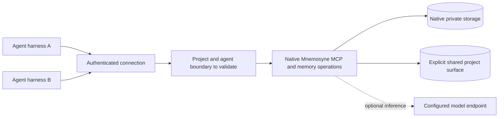
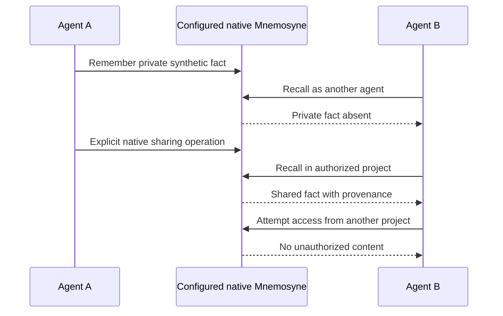
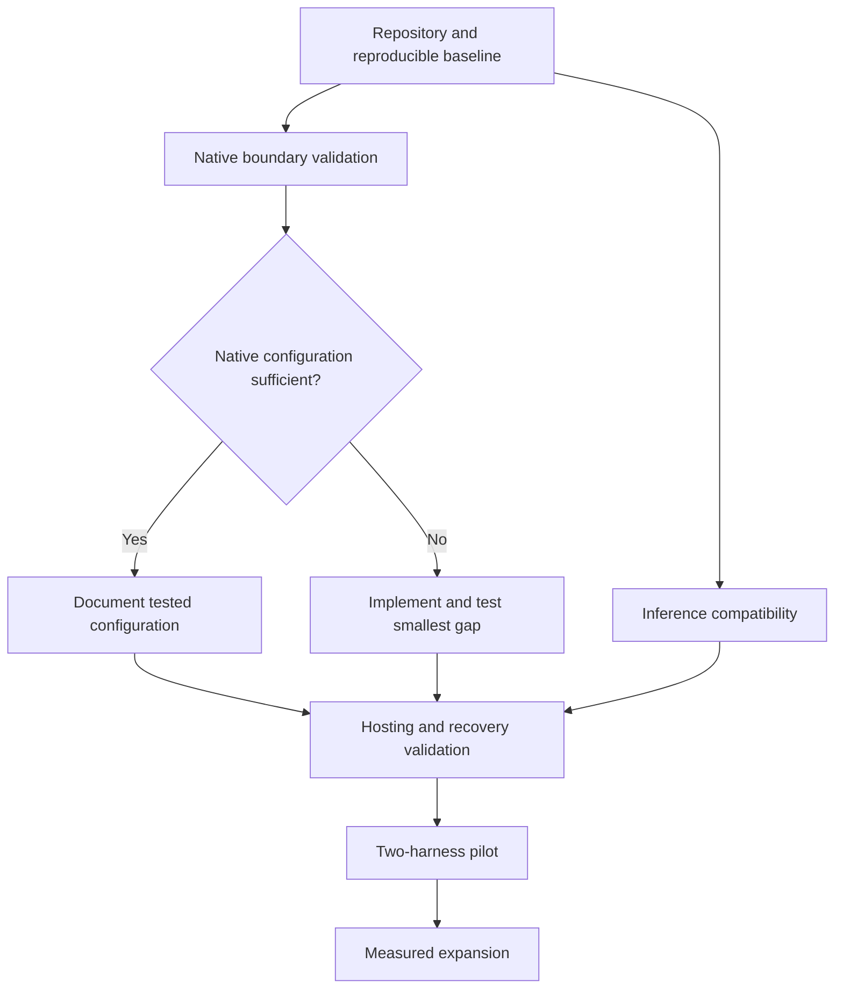

# Plan for team discussion

## What we retain and what remains unproven

| Area | Upstream already has | Validate for adoption |
| --- | --- | --- |
| Storage | SQLite, BEAM, named banks | Native lifecycle and restart behavior; no replacement schema |
| Sharing | Session/global scopes, author/channel fields, shared-memory tools | Deliberate sharing with the intended project audience |
| Transport | MCP SSE and Streamable HTTP | Selected harness compatibility and reconnects |
| Identity | Named bearer tokens bound to author identity | Every permitted read/write path follows required project/agent boundaries |
| Sync | Event/delta machinery and scoped surfaces | Whether remote access alone suffices; sync only if offline use is needed |
| Inference | Configurable backends | Custom endpoint support for LLM and embeddings separately |

Source review at the pinned commit found:

- `_resolve_bank()` in `mnemosyne/mcp_tools.py` accepts a caller-selected bank before the server default. A default bank alone is not a project access policy.
- `_create_instance()` binds named-token author identity but defaults the session to `mcp_<bank>`. Authenticated author attribution alone does not imply private recall isolation.
- Shared-memory handlers use the separately configured `MNEMOSYNE_SHARED_DB_PATH`. Test its boundary independently of named banks.

These mechanisms can be appropriate for trusted shared deployments. The task is to verify which configuration or deployment boundaries meet our requirements before adding a gateway.

Prior local evidence: 73 selected upstream bank, identity, routing and token-binding tests passed against the pinned commit. A synthetic handler-level check found that agent B could recall agent A's session-scoped record in the same MCP bank, while a different bank returned no matching record. Neither result is a complete network/harness security assessment. Reproduce the evidence in a committed fixture before relying on it as a regression gate.

## Intended behavior

Memories remain private until deliberately shared with an authorized project audience. “Private” refers to separation from other agents through the selected deployment, not protection from a trusted storage operator. No human approval queue is implied. Retrieval and consolidation remain native Mnemosyne behavior.

The boundary is a required property, not a newly selected gateway. Separate upstream processes/storage/credentials may supply it. Private/shared nodes describe visibility; exact bank/process layout follows validation.

This is the target acceptance sequence, not a claim that every default upstream configuration passes it.

## Ordered work

1. **Establish provenance.** Public fork, preserved MIT notices, pinned source, isolated docs, update procedure. Keep internal planning separate.
2. **Native validation.** Two synthetic agents and two projects. Enumerate exposed tools; test normal, shared, export, admin, ingestion and diagnostic paths. Test author spoofing, bank/channel overrides, explicit sharing, deletion, restart and retries over actual authenticated MCP.
3. **Choose the smallest implementation.** Record what native config/process isolation satisfies. Patch only observed gaps; update diagrams and executable acceptance tests. No gateway/control database unless evidence requires it.
4. **Inference compatibility.** Test custom model endpoint, LLM and embedding APIs, dimensions, effective configuration, timeouts, outage handling and observed destinations. No silent provider substitution.
5. **Hosting and recovery.** Measure resources and recurring costs, choose a portable host, define retention and recovery objectives, then restore into a clean instance and prove scoped retrieval/deletion behavior.
6. **Pilot.** Two real harnesses and two agreed projects, then gradual expansion. Record useful recall, latency, failures, storage growth and inference usage. Document rollback.

## Team decisions

| Question | Recommended discussion starting point | Needed when |
| --- | --- | --- |
| Which two harnesses go first? | Codex and the team's next most-used harness | Before real client tests |
| Must memory work offline, or is cloud availability enough initially? | Central remote access first unless offline operation is essential | Before topology selection |
| Which two projects form the pilot? | Synthetic projects for probes, then two explicitly named real projects | Before real data |
| What data loss, outage and backup retention are acceptable? | Choose measured, affordable targets after restore experiments | Before deployment |
| Does a verified gap need a wrapper or an upstream patch? | Prefer native configuration, then a focused reusable patch | After validation |

Record accepted answers with date and evidence. Do not invent owners, commitments or approval. Commercial packaging, name, billing and service commitments are deferred beyond the internal pilot.

## Ready to start

The team can start synthetic validation after selecting an assignee. Deliver a runnable experiment, dependency/version record, expected-versus-observed matrix, and recommendation. A Mermaid parse or unit-test pass alone does not prove multi-harness deployment readiness.
